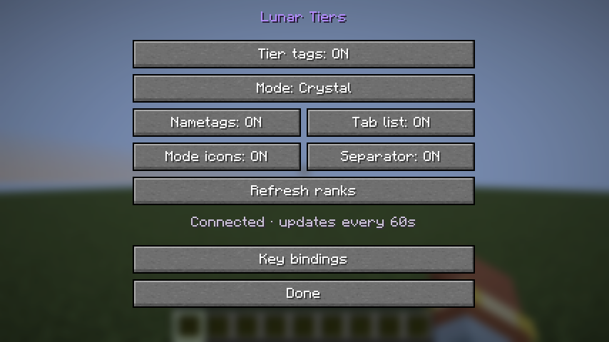
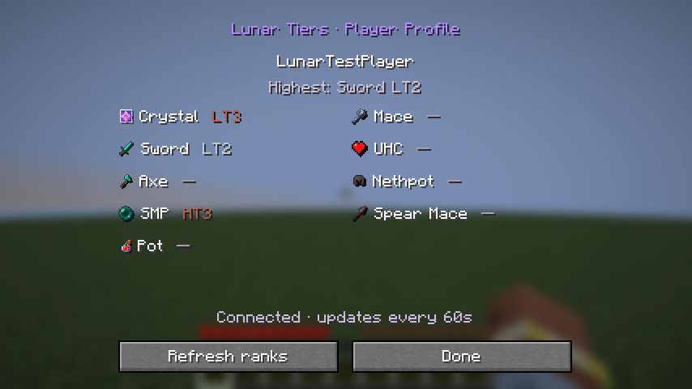

# Lunar Tiers Tagger

Lunar ranks on Minecraft player nametags and the Tab list. Client-side Fabric mod for **1.21.11**, **26.2**, and **26.3**.

**Connected implementation candidate.** The read-only API is live at `https://lunar-ranks.cattiers.com/v1/ranks/lookup`. RC5 adds a nearby-player profile and dedicated controls for all three versions, with the supplied Lunar mode icons. RC3/RC4 are also connected; RC1/RC2 have no embedded address. Broader multiplayer rehearsal remains pending. The existing Discord bot has not been restarted.

## What it shows

Supported modes: **Crystal, Sword, Axe, SMP, Pot, Mace, UHC, Nethpot, and Spear Mace**.

The default display is `mode icon HT3 | PlayerName`, using the highest saved rank across all modes. Press **I** to choose a specific mode or change the display. You can rebind the key in Minecraft Controls. Settings include independent nametag and Tab toggles, icons, separators, refresh, and API connection status.

Press **P** in-game to open the closest visible player's Lunar profile within **32 blocks**. It shows their name, highest visible tier, and all nine modes with their icons and saved ranks. Missing ranks show a dash; this can mean unlinked, unranked, or restricted. Self, invisible players, spectators, and players blocked from line of sight are excluded. The selected profile stays on that player until closed. Refresh uses the existing asynchronous rank client; no extra private profile information is requested.

Change either shortcut under **Options → Controls → Key Binds → Lunar Tiers**, or use **I → Key bindings**. The settings key keeps existing custom bindings. P also defaults to Minecraft's Social Interactions; the Lunar profile shortcut takes priority in-world while the bindings overlap. Rebind one to use both separately. Keyboard and mouse bindings use Minecraft's normal save/reset controls.

Ranks use Minecraft UUIDs, not usernames. They appear on any multiplayer server where the player's UUID matches a linked Lunar account. Unlinked and unranked players have no tag. Server-formatted names keep their existing text and colors; chat names and normal nametag visibility are unchanged.

Auto sorts tiers HT1 → LT1 → HT2 → LT2 → HT3 → LT3 → HT4 → LT4 → HT5 → LT5. Equal ranks use this fixed mode priority: Crystal, Sword, Axe, SMP, Pot, Mace, UHC, Nethpot, Spear Mace. A restriction hides that Discord server's modes only. Saved ranks remain visible after a member leaves Discord.

## Install

1. Install Fabric Loader **0.20.1 or newer** for the exact Minecraft version you play.
2. Install the corresponding Fabric API: **0.141.6+1.21.11**, **0.161.0+26.2**, or **0.165.2+26.3**.
3. Put only the matching `lunar-tiers-tagger-<minecraft>-0.1.0.jar` into your instance's `mods` directory. Use Java **21** for 1.21.11 and Java **25** for 26.2/26.3.
4. Start Minecraft and press **I**. No server plugin or Discord login is required.

Settings are saved in `config/lunartiers-tagger.json`. This is separate from the old Cat Tiers mod. Avoid running two nametag rank mods together if you want only one prefix.

RC3 and newer embed the live address and use it when the saved address is empty. For older offline candidates or an existing settings file with a different address, set `apiUrl` after closing Minecraft:

```json
{
  "enabled": true,
  "nametags": true,
  "tab": true,
  "icons": true,
  "separator": true,
  "mode": "auto",
  "apiUrl": "https://lunar-ranks.cattiers.com/v1/ranks/lookup"
}
```

No passwords, database keys, or bot tokens belong in this file or in the mod.





## Build and test

Install JDK 21 and JDK 25, plus Node **24.17+**. The Gradle wrapper is included and verifies its downloaded distribution checksum. On Linux/macOS use `bash ./gradlew`; on Windows use `./gradlew.bat`.

```sh
npm test
bash ./gradlew :common:test releaseJars
node scripts/verify-jars.mjs
npm run load-test
```

For connected release builds:

```sh
bash ./gradlew clean :common:test releaseJars -PrankApiUrl=https://YOUR_HOST/v1/ranks/lookup
```

JARs are written to `build/release`. Do not rename one version's JAR to claim compatibility with another version.

The client game tests launch Minecraft, create a temporary singleplayer world, test the display hooks and settings, capture a screenshot, and exit. They require a working graphics environment. Their isolated test mod is never included in release JARs.

```sh
bash ./gradlew :mc12111:runClientGameTest
bash ./gradlew :mc262:runClientGameTest
bash ./gradlew :mc263:runClientGameTest
```

GitHub Actions builds/tests on Windows and Linux and runs Minecraft startup/settings smoke tests for each version on Linux under Xvfb. Full world tests passed locally on all three versions and remain the default for the commands above. A manual workflow option also enables them in CI; shared Linux runners have a documented world-loading timeout. See [validation and limits](docs/VALIDATION.md) for measured results and remaining live checks.

## Rank API

The API is a separate, read-only Node service on the bot VM. It opens the existing SQLite database read-only, checks its revision every five seconds, and keeps a minimal public rank projection in memory. Requests never read the database. No schema migration is required.

Clients fetch the current multiplayer player list in batches of up to 100 UUIDs, with a 60-second cache, one background fetch worker, and bounded retry backoff. No network request runs during rendering. Cached tags expire after five minutes without a successful refresh and are cleared on disconnect.

See [deployment instructions](docs/DEPLOYMENT.md), [the API contract](docs/API.md), and [release status](docs/RELEASE-STATUS.md).

## Repository layout

- `common`: networking, bounded cache, rank selection, and Java tests.
- `client`, `client26`, `mc12111`, `mc262`, `mc263`: shared mod code and version adapters.
- `api`: read-only database projection, HTTP service, regression tests, and load test.
- `gametest`: isolated in-game tests; `deploy`: service and HTTPS examples.

RC4 uses the nine PNG icons supplied for Lunar Tiers: spear (Spear Mace), ender pearl (SMP), red potion (Pot), netherite helmet (Nethpot), diamond axe (Axe), crystal (Crystal), mace (Mace), diamond sword (Sword), and red heart (UHC). The files retain their original pixels and transparency. Fonts and configuration use the `lunartiers` namespace. The earlier [Cat Tiers Tagger](https://github.com/raincakecat/Cat-Tiers-Tier-Tagger) served as a reference; the networking and display integration were rewritten for Lunar's current data model.
